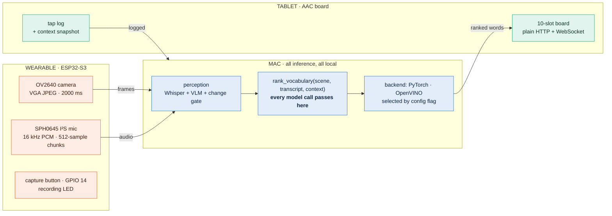
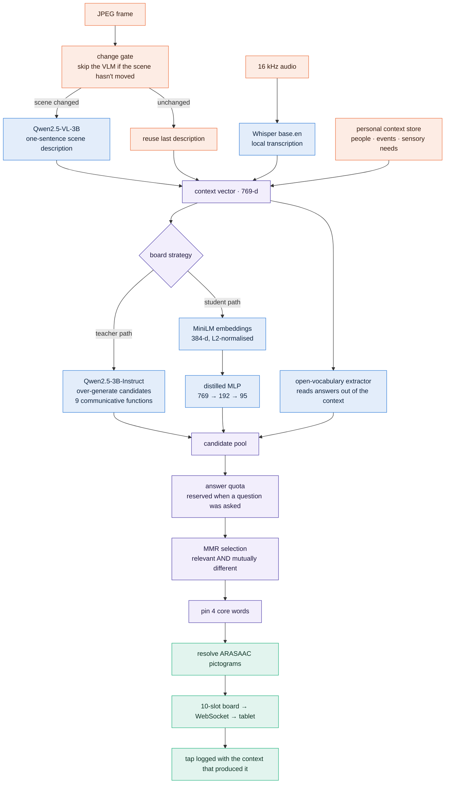
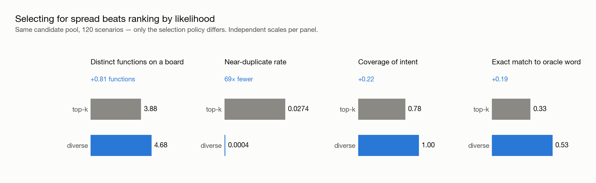
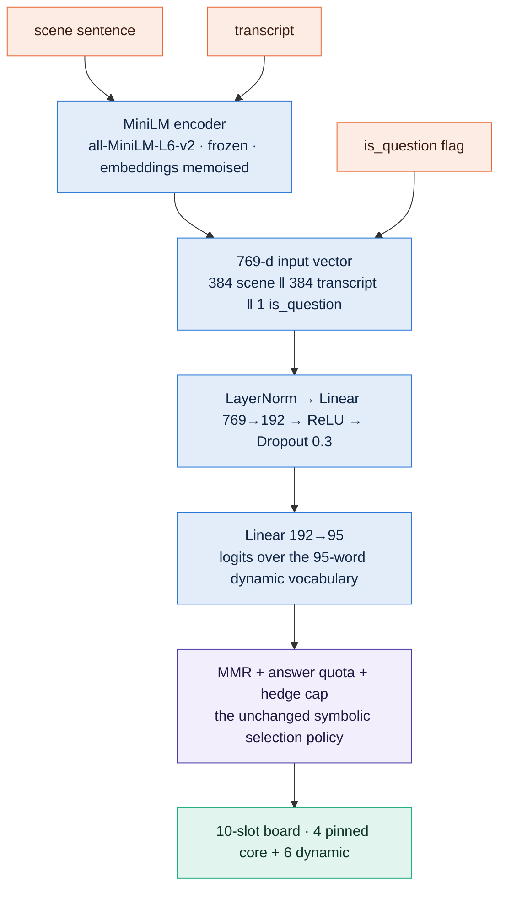

<div align="center">


# Revoce

A wearable that senses the room and the conversation, and puts the words a
nonverbal person needs onto their AAC board before they have to ask for them.

[](https://www.python.org/)
[](https://pytorch.org/)
[](https://docs.openvino.ai/)
[](https://onnx.ai/)
[](https://www.espressif.com/)

</div>

---

## The problem

An AAC board is a grid of tappable words, and someone has to program it in
advance. If the word you need isn't on it, you can't say the thing you mean.
Nobody can pre-program a board for every situation a person will walk into.

Around 4–5 million people in the U.S. can't reliably meet their daily
communication needs with speech. Dedicated speech-generating devices run
$4,000–$12,000 with 3–18 month reimbursement cycles, and 30–35% are abandoned
within a year — boards that don't match the user's real context are a named
cause. AAC users communicate at roughly a tenth of conversational speed.
Sources for all of these are in [`docs/COMPETITION_EVIDENCE.md`](docs/COMPETITION_EVIDENCE.md).

## What it does

The board holds ten slots. Four are pinned permanently — *yes*, *no*,
*I need help*, *wait* — chosen as four different communicative functions, so a
bad model output can never leave someone without them. The other six are
selected fresh for the moment.

> **Scene** — a classroom, a teacher at a whiteboard with a diagram of a plant
> **Heard** — *"What do plants take in from the air?"*
> **Board gains** — **carbon dioxide**, *oxygen and water*, *sun*,
> *I am not sure*, *can you repeat that*, *I know this one*

At a family meal, *"Who do you want to sit next to?"* surfaces **aunt** — a word
that isn't in the system's fixed vocabulary at all, and reaches the board
through the open-vocabulary path described further down.

## Architecture

Three devices. The wearable does no processing, and neither does the tablet —
both reach intelligence only by asking the Mac.



Every model call in the system goes through one function with a fixed signature:

```python
rank_vocabulary(scene, transcript, context) -> ranked_words
```

Nothing else touches a model. That constraint is why the inference stack could
be moved from PyTorch on Apple silicon to OpenVINO on Intel by changing a
config flag rather than editing a route, the firmware, or a line of UI.

## How a board is made



The step that matters is the selection stage. Rather than predicting the single likeliest reply,
the ranker over-generates across nine communicative functions and then selects
six that are relevant *and different from each other*. A board of six
paraphrases of one answer is a failure even if every phrase is good.

---

## Results

### Selecting for spread, not for likelihood

Same candidate pool, same 120 scenarios — the only thing that changes is the
selection policy.

<picture>
  <source media="(prefers-color-scheme: dark)" srcset="docs/figures/diversity-dark.png">
  
</picture>

### A 3-billion-parameter teacher, replaced by a 190 KB model

The teacher produces good boards and takes about seven seconds, which is
unusable in conversation. Its boards became a training set — 600 rows, 559 after
deduplication, 84 held out and never trained on.

| | Student | Teacher |
|---|---:|---:|
| Board latency, end to end | **10.135 ms** | 7.05 s |
| Functional diversity retained | 95.3% | — |
| Measured speedup | **695×** *(n=8 teacher samples)* | — |

Teacher latency drifts run to run — 7.05 s as committed, 10.6 s and 11.7 s seen
on a loaded machine. Where a claim needs to be safe, `>400×` is the honest form.
Of the 10 ms board, the distilled head is about 0.1 ms; the real cost is MiniLM,
a 22M-parameter transformer sitting on the critical path.

What the student actually is — MiniLM does the reading, a tiny MLP does the
scoring, and the teacher's own selection policy still does the choosing:



### The gates, including the two that don't pass

Scored on the held-out split. The metrics are anti-gaming by construction: a
system that returns the same excellent board every time should score badly, and
this one is measured on whether it does.

| Gate | Student | Teacher | Verdict |
|---|---:|---:|---|
| Distinct functions @7 | 4.095 | 4.298 | ✅ pass — 0.953 retained |
| Near-duplicate rate | 0.000 | 0.0006 | ✅ pass |
| Board variety | 0.952 | — | ✅ pass — 80/84 distinct |
| Coverage of intent (dynamic) | 0.789 | 0.873 | ⚠️ **inconclusive** — 0.904×, margin +0.003 |
| Same-function-pair rate | 0.1893 | 0.1735 | ❌ **fail** — bar is ≤ teacher |
| Teacher word agreement | 0.067 | — | report-only |

The same-function-pair gate has failed through three review rounds and is
reported as failing — the fix that closes it drops coverage of intent below its
own bar, and the two remain in tension. Coverage of intent clears its bar by
0.003, which the harness scores as inconclusive at n=71, and it is written up
as inconclusive, not as a pass.

### Why more data made agreement worse

The first student agreed with the teacher's exact word choices 23% of the time
against a 45% target. More data made it *worse* — 16%, then 6.7% — while every
diversity and speed gate kept passing.

The cause is arithmetic. The teacher speaks an open vocabulary; the student
picks from a closed list.

<picture>
  <source media="(prefers-color-scheme: dark)" srcset="docs/figures/ceiling-dark.png">
  
</picture>

Word overlap was measuring the size of the label space, not the quality of the
student. Coverage of intent became the gated metric and word agreement was
demoted to report-only. The fix isn't a longer list: concrete answers are now
read straight out of the scene or transcript by the open-vocabulary extractor,
so a word that was never in the vocabulary — *aunt*, at that family meal — can
still reach the board. On 60 authored deictic questions it answers 100% of
*who* and alternative questions against at most 8% for the closed vocabulary
alone; the full breakdown is in
[`docs/overview/`](docs/overview/).

### Intel and OpenVINO

The student exports to ONNX, converts to OpenVINO IR at `1.43e-6` logit parity,
and quantizes to INT8 with NNCF calibrated on 360 real feature vectors rather
than random noise. A vocabulary hash ships beside every artifact, so an IR built
against a different word list fails loudly instead of quietly serving the wrong
words.

Run on a Core Ultra 9 185H, the same unmodified IR inverts by CPU vendor:

<picture>
  <source media="(prefers-color-scheme: dark)" srcset="docs/figures/inversion-dark.png">
  
</picture>

That's a within-machine ratio, so it isn't affected by the OS and version
differences between the two hosts. Moving the embedder to OpenVINO speeds the
whole board up 2.02× on Intel CPU, 1.85× on the Arc iGPU, and 1.76× on the Mac.

Two honest footnotes: INT8 is a footprint result, not a speed one — 236 KB
against 662 KB, marginally *slower* than FP32 on both machines. And the NPU
does not work: it needs statically shaped graphs and the IR carries a dynamic
batch axis. A batch-1 static export would probably compile; it hasn't been
done, so it isn't claimed.

---

## Quickstart

Python 3.9+. Apple silicon for the local LLM and VLM; on Intel, serve the
student through OpenVINO instead — see [`mac/intel/`](mac/intel/).

```bash
git clone https://github.com/tanayvin1216/VoiceLink && cd VoiceLink
python3 -m venv .venv && source .venv/bin/activate
pip install -r mac/requirements-dev.txt

cd mac
VOICELINK_PERCEPTION=0 pytest tests/ -q     # 213 passed
```

Bring the whole system up:

```bash
bash mac/demo.sh              # real wearable, real models
bash mac/demo.sh --fake       # no ESP32 needed
bash mac/demo.sh --student    # distilled student instead of the LLM
bash mac/demo.sh --intel      # student + MiniLM + Whisper all on OpenVINO
bash mac/demo.sh --mock       # no models at all
```

Flags combine. The board is at `http://<mac>:8080/`, served over plain HTTP on
purpose — a tablet on the same network reaches it without the HTTPS
mixed-content wall.

## Repo map

| Path | What's there |
|---|---|
| [`mac/rank_vocabulary.py`](mac/rank_vocabulary.py) | the seam — every model call |
| [`mac/server.py`](mac/server.py) | HTTP + WebSocket, tap logging |
| [`mac/evaluation/phase4/`](mac/evaluation/phase4/) | student, training, gates, results |
| [`mac/intel/`](mac/intel/) | ONNX → IR conversion, NNCF quantization, benchmarks |
| [`firmware/voicelink_capture/`](firmware/voicelink_capture/) | ESP32-S3 capture, button, LED |
| [`docs/VERIFIED_NUMBERS.md`](docs/VERIFIED_NUMBERS.md) | every quotable figure and its source |
| [`docs/overview/`](docs/overview/) | full technical write-up (LaTeX + PDF) |
| [`docs/figures/make_figures.py`](docs/figures/make_figures.py) | regenerates every chart above from the committed JSON |
| [`paper/`](paper/) | three NeurIPS 2026 workshop drafts |

Every figure in this README is generated from a committed artifact. If a number
here ever disagrees with the JSON it came from, the JSON is right — run
`python3 docs/figures/make_figures.py` and the charts catch up.

## Privacy

A body-worn camera and microphone in a room with other people is the central
ethical problem here, and the answer is structural rather than a policy page.

- **Local only.** Every model runs on the Mac. No audio, video or transcript is
  transmitted anywhere.
- **Nothing persists.** Buffers are ephemeral; the privacy endpoint reports no
  media artifacts on disk.
- **A hardware kill switch.** A debounced button on GPIO 14 toggles capture on
  the device. While paused the audio DMA still drains — so timing stays clean
  across pause and resume — but nothing is converted or sent and no frames are
  grabbed.
- **A visible indicator.** An LED is lit whenever capture is active, as a signal
  to people nearby.
- **Pseudonymisation tooling** for the tap log, and a proxy consent template for
  a guardian of someone who cannot consent for themselves.

Until written proxy consent and pseudonym handling are in place, the system is
built and tested on the project team only.

## Attribution

Pictograms are from [ARASAAC](https://arasaac.org/), licensed CC BY-NC-SA —
non-commercial. Any commercial deployment would need a different symbol set.
