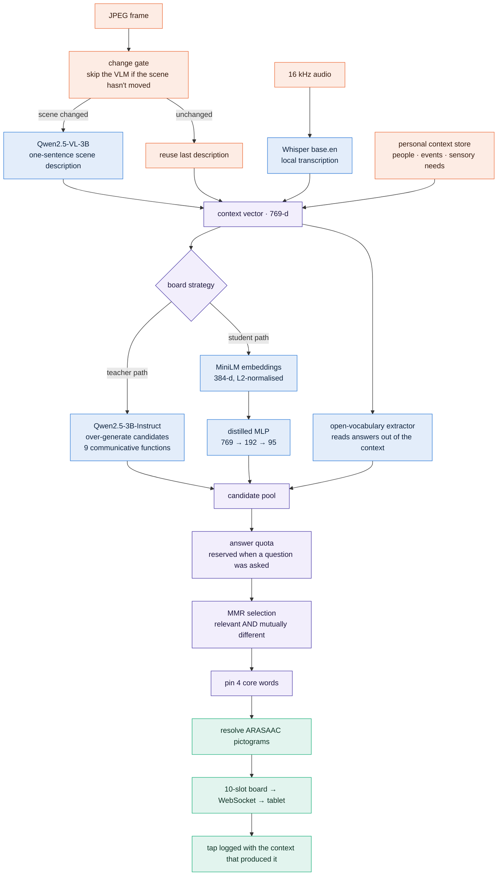
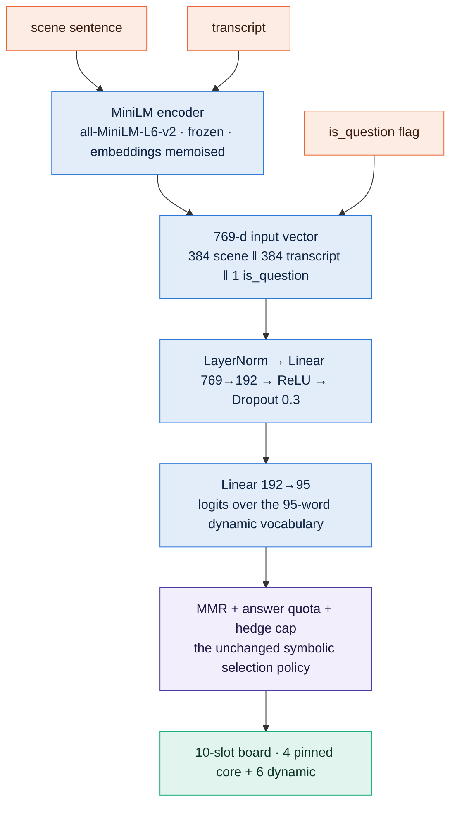

<div align="center">


# Revoce

**The right words, already on the board.**

Revoce is a wearable that listens to the conversation and looks at the room, so a
nonverbal person's AAC board already has the words they need by the time they
need them. No one has to program it in advance.

### [revoce.ai](https://revoce.ai/)

[](https://www.python.org/)
[](https://pytorch.org/)
[](https://docs.openvino.ai/)
[](https://onnx.ai/)
[](https://www.espressif.com/)

</div>

### Recognized by

| | |
|---|---|
| 🏆 | **Intel Global AI Impact Festival 2026** — Global Award Winner |
| 🎓 | **AI for Education** — Global Award Finalist |
| 📄 | **NeurIPS 2026 Workshops** — SLM, ODI and GenAI4Health |
| 🗣️ | **International Society for Augmentative and Alternative Communication (ISAAC)** |

---

## Abstract

Augmentative and alternative communication (AAC) boards only contain the words
someone programmed into them ahead of time, which breaks down the moment a user
walks into a situation nobody planned for. Revoce is a context-aware AAC system
built from three devices: an ESP32-S3 wearable that captures audio and images,
a computer that runs every model locally, and a tablet that shows a ten-slot
board. Instead of picking the single most likely reply, Revoce generates
candidates across nine communicative functions and selects six that are both
relevant and different from each other. On 120 scenarios this raises coverage
of communicative intent from 0.78 to 1.00 compared with top-k ranking over the
same candidates. We then distill a 3B-parameter teacher into a 190 KB student
that builds a board in about 10 ms instead of 7 s, while keeping 95.3% of the
teacher's functional diversity. Finally, we export the student to OpenVINO and
find that the same IR is 2.66× faster than PyTorch on an Intel Core Ultra 9
but 0.60× on an Apple M4. We report the two evaluation gates the student still
fails alongside the ones it passes.

## Contents

1. [The problem](#1-the-problem)
2. [What it does](#2-what-it-does)
3. [System architecture](#3-system-architecture)
4. [How the board is generated](#4-how-the-board-is-generated)
5. [Results](#5-results)
6. [Intel and OpenVINO](#6-intel-and-openvino)
7. [Quickstart](#7-quickstart)
8. [Repository structure](#8-repository-structure)
9. [Privacy](#9-privacy)
10. [Citation and attribution](#10-citation-and-attribution)

---

## 1. The problem

A traditional AAC board is a grid of words and phrases that a user taps to
communicate. Someone has to program that grid ahead of time, and it is very hard
to anticipate every situation a person will run into over the course of a day.
If the word they need isn't there, they can't say it.

Around 4–5 million people in the United States cannot reliably meet their daily
communication needs through speech. Dedicated speech-generating devices cost
between $4,000 and $12,000, with reimbursement cycles of 3 to 18 months. Roughly
30–35% of these devices are abandoned within the first year, partly because the
vocabulary on them doesn't match what users actually need to say. AAC users also
communicate at about one-tenth of typical conversational speed.

Sources for these figures are in
[`docs/COMPETITION_EVIDENCE.md`](docs/COMPETITION_EVIDENCE.md).

## 2. What it does

The board has ten slots. Four of them are always there: *yes*, *no*,
*I need help* and *wait*. We picked these because each one covers a different
communicative function, and we didn't want a bad model prediction to ever take
them away.

The other six slots change based on what's happening around the user.

For example, if a student is in a classroom and the teacher asks *"What do
plants take in from the air?"*, the board might show:

| Answers | Other ways to respond |
|---|---|
| **carbon dioxide** | I am not sure |
| oxygen and water | can you repeat that? |
| sun | I know this one |

We wanted the board to offer more than just answers. A user should also be able
to say they're unsure, ask for the question again, or join in some other way.

The system can also suggest words that aren't in its fixed vocabulary. At a
family meal, *"Who do you want to sit next to?"* can bring up **aunt**, even
though that word was never on the list. Section 5.4 explains how.

## 3. System architecture

The system has three devices. The wearable captures audio and images, the
computer runs the models, and the tablet shows the board. Neither the wearable
nor the tablet does any processing of its own.


<p align="center"><sub><b>Figure 1.</b> System overview. The wearable streams
frames and audio to the computer, which is the only device that runs models.
The tablet receives ranked words over a WebSocket and logs every tap together
with the context that produced the board.</sub></p>

We designed the software so that every model call goes through a single
function:

```python
rank_vocabulary(scene, transcript, context) -> ranked_words
```

Keeping inference behind this one function made it much easier to try
different models and hardware. For example, we moved from PyTorch on Apple
silicon to OpenVINO on Intel hardware by changing a configuration flag, without
touching the firmware, the server routes or the UI.

## 4. How the board is generated

A lot of our work went into how the system decides which words to show.

Picking the highest-scoring words seemed like the obvious approach at first. In
practice it often gives you a board full of slightly different versions of the
same answer, which doesn't leave the user much to actually say.

So instead, the ranker generates candidates across nine communicative functions
and then picks six phrases based on both relevance and how different they are
from each other (maximal marginal relevance, or MMR).



<p align="center"><sub><b>Figure 2.</b> Board generation pipeline. Orange:
sensing and personal context. Blue: models. Purple: the selection policy, which
is shared by the teacher and the student. Green: output to the tablet.</sub></p>

---

## 5. Results

### 5.1 Vocabulary selection

We compared standard top-k ranking with our diversity-based selection across 120
scenarios. Both used exactly the same candidate pool, so the only thing that
changes is the selection policy.

<p align="center"><sub><b>Table 1.</b> Top-k vs. diverse selection over the same
candidate pool (n = 120 scenarios).</sub></p>

| Metric | Top-k | Diverse selection |
|---|---:|---:|
| Distinct communicative functions ↑ | 3.88 | **4.68** |
| Near-duplicate rate ↓ | 0.0274 | **0.0004** |
| Coverage of intent ↑ | 0.78 | **1.00** |
| Exact match ↑ | 0.33 | **0.53** |

<picture>
  <source media="(prefers-color-scheme: dark)" srcset="docs/figures/diversity-dark.png">
  
</picture>

<p align="center"><sub><b>Figure 3.</b> The same four metrics as Table 1.
Selecting for diversity covers more of what the user might mean and almost
eliminates near-duplicate suggestions.</sub></p>

### 5.2 Model distillation

Our original 3B-parameter teacher made good boards, but each one took about seven
seconds. That's far too slow for a real conversation.

To fix this, we used the teacher's outputs to train a much smaller student. We
generated 600 training examples, which came down to 559 after deduplication. We
held out 84 of them for evaluation and never trained on those.

<p align="center"><sub><b>Table 2.</b> Student vs. teacher on the 84-example
held-out split.</sub></p>

| Metric | Student | Teacher |
|---|---:|---:|
| End-to-end board latency | **10.135 ms** | 7.05 s |
| Functional diversity retained | 95.3% | — |
| Measured speedup | **695×** | — |

The 695× figure comes from eight teacher samples. Teacher latency moves around
with machine load, and we also saw runs of 10.6 s and 11.7 s, so when we report
the speedup we use the more conservative "over 400×".

The student is made of three parts. MiniLM encodes the input, a small multilayer
perceptron (MLP) scores the vocabulary, and the same selection policy the teacher
uses builds the final board.



<p align="center"><sub><b>Figure 4.</b> Student architecture. Only the MLP head
is trained. The encoder is frozen and the selection policy is the same one the
teacher uses.</sub></p>

The distilled head itself is about 190 KB and runs in roughly 0.1 ms. Almost all
of the remaining latency comes from MiniLM, a 22M-parameter transformer, which is
why moving the encoder to OpenVINO helped much more than moving the head
(Figure 5).

<picture>
  <source media="(prefers-color-scheme: dark)" srcset="docs/figures/latency-dark.png">
  
</picture>

<p align="center"><sub><b>Figure 5.</b> Median board latency on an Apple M4 over
the 84 held-out scenarios. Swapping only the head barely moves the number.
Moving MiniLM to OpenVINO gives a 1.76× speedup.</sub></p>

### 5.3 Evaluation gates

We scored the student on the held-out split using several gates. A big part of
what we wanted to check was whether the model was actually reacting to context,
rather than producing the same generally useful board every time. A model that
did that should score badly here.

<p align="center"><sub><b>Table 3.</b> Evaluation gates on the held-out split.
"Report only" metrics are tracked but don't gate a release.</sub></p>

| Metric | Student | Teacher | Result |
|---|---:|---:|---|
| Distinct functions @7 ↑ | 4.095 | 4.298 | ✅ Pass |
| Near-duplicate rate ↓ | 0.000 | 0.0006 | ✅ Pass |
| Board variety ↑ | 0.952 | — | ✅ Pass |
| Coverage of intent (dynamic) ↑ | 0.789 | 0.873 | ⚠️ Inconclusive |
| Same-function-pair rate ↓ | 0.1893 | 0.1735 | ❌ Fail |
| Teacher word agreement ↑ | 0.067 | — | Report only |

The student kept 95.3% of the teacher's functional diversity and produced 80
distinct boards across the 84 held-out examples.

There are still two things we need to fix. The same-function-pair rate has
failed its threshold across three rounds of testing, and every change we tried
that improved it also pushed coverage of intent below its own threshold.
Coverage of intent itself only clears its bar by 0.003, and with a sample size
of 71 we don't think that counts as a pass, so we report it as inconclusive.
We're still working on improving both without trading one for the other.

### 5.4 Why more training data made word agreement worse

One result surprised us. Adding more training data actually *lowered* how often
the student picked the same words as the teacher.

The first student agreed with the teacher's exact words 23% of the time, against
a target of 45%. As we added data, that fell to 16% and then 6.7%, even though
the student kept passing every speed and diversity gate.

When we dug into it, most of the gap came down to vocabulary. The teacher can
produce any word it wants, but the student can only choose from a fixed list of
95.

<picture>
  <source media="(prefers-color-scheme: dark)" srcset="docs/figures/ceiling-dark.png">
  
</picture>

<p align="center"><sub><b>Figure 6.</b> Fraction of the teacher's word slots
that a closed vocabulary can represent, by vocabulary size. 95 words cover 33%.
Making the list 8.5× bigger only gets to 57%.</sub></p>

This made us question whether exact word agreement was a fair way to judge the
student at all. We switched our main metric to coverage of communicative intent
and kept reporting word agreement on the side.

We also built an open-vocabulary extractor that pulls answers directly out of
the scene description or the transcript. That's how a word like *aunt* can reach
the board even though it was never in the vocabulary. We tested it on 60
questions we wrote where the answer is present in the context.

<picture>
  <source media="(prefers-color-scheme: dark)" srcset="docs/figures/deictic-dark.png">
  
</picture>

<p align="center"><sub><b>Figure 7.</b> Open-vocabulary extractor vs. the closed
vocabulary on 60 authored deictic questions. On <i>who</i> and alternative
questions the extractor gets 100%, compared with at most 8% for the closed
vocabulary. Counting questions are not handled yet.</sub></p>

The full evaluation is in [`docs/overview/`](docs/overview/).

## 6. Intel and OpenVINO

We exported the student to ONNX and converted it to OpenVINO IR, with logits
matching PyTorch to within `1.43e-6`. We then used NNCF to quantize it to INT8,
calibrating on 360 feature vectors taken from real inputs instead of random data.

Every exported model ships with a hash of the vocabulary it was trained on. If
it's loaded against a different word list, it fails loudly instead of quietly
showing the wrong words.

We ran the same IR on an Apple M4 and an Intel Core Ultra 9 185H.

<picture>
  <source media="(prefers-color-scheme: dark)" srcset="docs/figures/inversion-dark.png">
  
</picture>

<p align="center"><sub><b>Figure 8.</b> Speedup of the OpenVINO student head over
PyTorch on the same machine. The same unmodified IR is slower than PyTorch on
the M4 and 2.66× faster on the Intel CPU.</sub></p>

These numbers compare OpenVINO with PyTorch on each machine. They are not a
comparison of absolute times across the two machines, so OS and library
differences between them don't affect the ratio.

<p align="center"><sub><b>Table 4.</b> Whole-board speedup from moving the
MiniLM embedder to OpenVINO.</sub></p>

| Hardware | Board generation speedup |
|---|---:|
| Intel CPU | 2.02× |
| Intel Arc iGPU | 1.85× |
| Apple M4 | 1.76× |

INT8 quantization shrank the model from 662 KB to 236 KB, but it ran slightly
slower than FP32 on both machines. So the benefit there is storage, not speed.

We haven't gotten the model running on the Intel NPU yet. The current IR has a
dynamic batch axis, and the NPU needs statically shaped graphs. Exporting a
fixed batch-size-one model is the obvious next step, but we haven't tried it.

---

## 7. Quickstart

You'll need Python 3.9 or newer. The local LLM and VLM currently run on Apple
silicon. On Intel hardware you can serve the distilled student through OpenVINO
instead; see [`mac/intel/`](mac/intel/).

```bash
git clone https://github.com/tanayvin1216/VoiceLink && cd VoiceLink
python3 -m venv .venv && source .venv/bin/activate
pip install -r mac/requirements-dev.txt
```

Run the tests (213 should pass):

```bash
cd mac
VOICELINK_PERCEPTION=0 pytest tests/ -q
```

Start the system:

```bash
bash mac/demo.sh              # real wearable, real models
bash mac/demo.sh --fake       # no ESP32 needed
bash mac/demo.sh --student    # distilled student instead of the LLM
bash mac/demo.sh --intel      # student, MiniLM and Whisper on OpenVINO
bash mac/demo.sh --mock       # no models at all
```

The flags can be combined. The board is served at `http://<mac>:8080/`. We use
plain HTTP on purpose so a tablet on the same network can open it without
running into HTTPS mixed-content errors.

## 8. Repository structure

| Path | Description |
|---|---|
| [`mac/rank_vocabulary.py`](mac/rank_vocabulary.py) | Vocabulary ranking; every model call goes through here |
| [`mac/server.py`](mac/server.py) | HTTP server, WebSocket and tap logging |
| [`mac/evaluation/phase4/`](mac/evaluation/phase4/) | Student model, training scripts, evaluation gates and results |
| [`mac/intel/`](mac/intel/) | ONNX → OpenVINO conversion, NNCF quantization and benchmarks |
| [`firmware/voicelink_capture/`](firmware/voicelink_capture/) | ESP32-S3 firmware for capture, the button and the LED |
| [`docs/VERIFIED_NUMBERS.md`](docs/VERIFIED_NUMBERS.md) | Every reported number and where it comes from |
| [`docs/overview/`](docs/overview/) | Full technical write-up (LaTeX and PDF) |
| [`docs/figures/make_figures.py`](docs/figures/make_figures.py) | Regenerates every figure in this README |
| [`paper/`](paper/) | NeurIPS 2026 workshop papers |

### Reproducing the figures

Every chart in this README is generated from evaluation results committed to the
repo. To rebuild them (light and dark versions):

```bash
python3 docs/figures/make_figures.py
```

| Figure | Source artifact |
|---|---|
| Fig. 3 — selection policy | `mac/evaluation/phase3/selftest_results.json` |
| Fig. 5 — board latency | `mac/intel/artifacts/e2e_mac.json` |
| Fig. 6 — vocabulary ceiling | AXIOM paper, Table 2 (transcribed) |
| Fig. 7 — open-vocabulary extractor | `mac/evaluation/phase4/phase4_results.json` |
| Fig. 8 — OpenVINO head speedup | `mac/intel/artifacts/head_bench_tanishlaptop.json` |

If a figure ever disagrees with its JSON, trust the JSON and rerun the script.

## 9. Privacy

Revoce uses a body-worn camera and microphone, often around other people, so
we've spent a lot of time thinking about the privacy of both the user and
everyone near them. Most of the safeguards are built into the hardware and
software rather than left to policy.

- **Local processing.** Every model runs on the computer. Audio, video and
  transcripts are never sent to an outside server.
- **Nothing saved.** Audio and images live in temporary buffers and are never
  written to disk. A privacy endpoint reports whether any media files exist on
  disk.
- **A physical off switch.** A button on GPIO 14 pauses and resumes capture.
  While paused, the audio DMA keeps draining so timing stays consistent, but no
  audio is converted or sent and no images are taken.
- **A visible recording light.** An LED stays on whenever capture is active, so
  people nearby can tell the device is listening.
- **Consent and pseudonymization.** The repo includes tools for pseudonymizing
  the tap log, plus a proxy consent template for guardians of people who can't
  consent for themselves.

Until written proxy consent and pseudonymization are in place, we only test with
members of the project team.

## 10. Citation and attribution

If you use Revoce in your work, please cite:

```bibtex
@misc{revoce2026,
  title        = {Revoce: Context-Aware AAC from a Wearable Camera and Microphone},
  author       = {{The Revoce Team}},
  year         = {2026},
  howpublished = {\url{https://revoce.ai/}},
  note         = {Code: \url{https://github.com/tanayvin1216/VoiceLink}}
}
```

The pictograms come from [ARASAAC](https://arasaac.org/) under the CC BY-NC-SA
license, which is non-commercial. A commercial deployment would need a different
symbol set.
