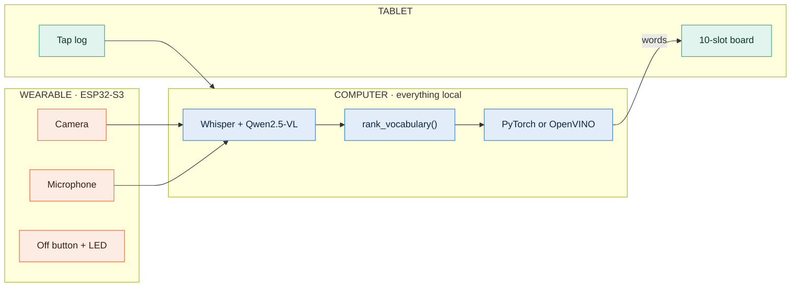
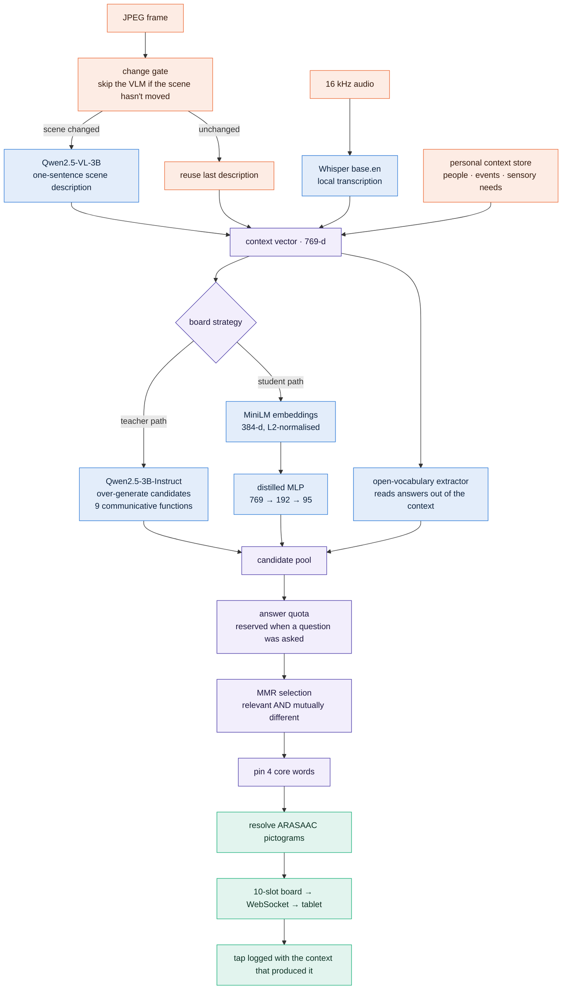
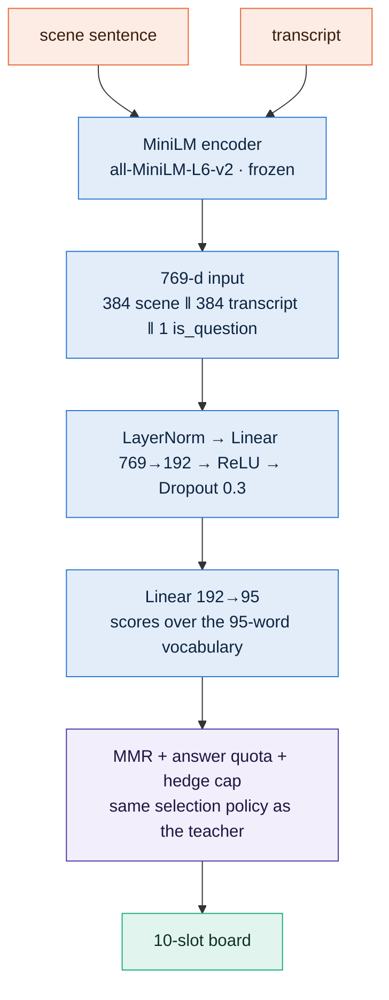

<div align="center">


# Revoce

## The right words, already on the board.

Revoce is a small wearable that listens to the conversation and looks at the room,
so a nonverbal person's AAC board has the words they need before they need them.

**[revoce.ai](https://revoce.ai/)**

<br>

**Intel Global AI Impact Festival 2026 Global Award Winner** · **AI for Education Global Award Finalist** · **NeurIPS 2026 Workshops: SLM, ODI and GenAI4Health** · **International Society for Augmentative and Alternative Communication (ISAAC)**

<br>

<table>
<tr>
<td align="center" width="200"><h2>10 ms</h2>to build a new board</td>
<td align="center" width="200"><h2>400×+</h2>faster than the model it learned from</td>
<td align="center" width="200"><h2>190 KB</h2>distilled model</td>
<td align="center" width="200"><h2>0</h2>bytes of audio or video sent to the cloud</td>
</tr>
</table>

</div>

<br>

## A board that keeps up with your day

An AAC board is a grid of words someone has to program in advance. Nobody can
program a board for every moment of a person's day, so when the word you need
isn't there, you can't say it.

Around 4–5 million people in the U.S. can't reliably meet their daily
communication needs through speech. Speech-generating devices cost $4,000 to
$12,000, and 30–35% of them are abandoned within a year, often because the
vocabulary doesn't fit the user's life.
([sources](docs/COMPETITION_EVIDENCE.md))

Revoce changes the board as the day changes. Four words are always there:
*yes*, *no*, *I need help* and *wait*. The other six update with what's
happening around you.

<table>
<tr>
<td width="50%" valign="top">

**In class.** The teacher asks *"What do plants take in from the air?"*

> **carbon dioxide** · oxygen and water · sun
> I am not sure · can you repeat that? · I know this one

</td>
<td width="50%" valign="top">

**At dinner.** Someone asks *"Who do you want to sit next to?"*

> **aunt** · ...

*"Aunt" was never in the vocabulary. Revoce read it from the conversation.*

</td>
</tr>
</table>

<br>

## More ways to answer, not just one answer

Most ranking systems show you the most likely words. That usually gives you six
versions of the same reply. Revoce generates candidates across nine
communicative functions and picks six that are relevant *and* different from
each other, so you can answer, hedge, ask for clarification or just join in.

Same candidates, 120 scenarios, only the selection changed:

<picture>
  <source media="(prefers-color-scheme: dark)" srcset="docs/figures/diversity-dark.png">
  
</picture>

<br>

## Fast enough for a real conversation

Our first version used a 3B-parameter model and took about 7 seconds per board.
By then the conversation has moved on. So we trained a tiny student model on the
teacher's boards: 559 examples, with 84 held out and never trained on.

The result builds a board in **10 ms** and keeps **95.3%** of the teacher's
variety. The model itself is 190 KB and runs in about 0.1 ms. Nearly all the
remaining time is the text encoder, which is why moving it to OpenVINO cut
latency almost in half.

<picture>
  <source media="(prefers-color-scheme: dark)" srcset="docs/figures/latency-dark.png">
  
</picture>

We measured a 695× speedup over the teacher, but teacher timing moves with
machine load (we've also seen 10.6 s and 11.7 s), so the number we stand behind
is **over 400×**.

<br>

## Words that were never on the list

Here's something that surprised us. The more data we trained on, the *less*
often the student picked the teacher's exact words: 23%, then 16%, then 6.7%.

The reason is that the student chooses from a fixed list of 95 words and the
teacher doesn't. That list can only cover a third of what the teacher says, and
making it 8.5× bigger only gets to 57%.

<picture>
  <source media="(prefers-color-scheme: dark)" srcset="docs/figures/ceiling-dark.png">
  
</picture>

A longer list wasn't the answer. Instead, Revoce pulls answers straight out of
what it sees and hears. On 60 test questions where the answer is in the scene or
conversation, it gets every *who* and *this-or-that* question right. A fixed
vocabulary gets at most 8%.

<picture>
  <source media="(prefers-color-scheme: dark)" srcset="docs/figures/deictic-dark.png">
  
</picture>

Counting questions ("how many?") aren't handled yet.

<br>

## Built to run on Intel

Every model call in Revoce goes through one function:

```python
rank_vocabulary(scene, transcript, context) -> ranked_words
```

Because of that, moving from PyTorch on a Mac to OpenVINO on Intel is a config
flag. The firmware, the server and the board didn't change.

The student converts to OpenVINO with outputs matching PyTorch to within
`1.43e-6`. On an Intel Core Ultra 9 185H it runs **2.66×** faster than PyTorch.
The exact same file runs slower than PyTorch on an Apple M4.

<picture>
  <source media="(prefers-color-scheme: dark)" srcset="docs/figures/inversion-dark.png">
  
</picture>

Moving the encoder to OpenVINO too speeds up the whole board by **2.02×** on
Intel CPU, **1.85×** on the Arc iGPU and **1.76×** on the Mac. INT8 quantization
shrinks the model from 662 KB to 236 KB, though it isn't any faster. The NPU
doesn't work yet because it needs a fixed batch size and our export has a
dynamic one.

<br>

## Private by design

A camera and microphone worn around other people is a serious thing, so privacy
is built into the hardware and the architecture, not added on later.

<table>
<tr>
<td width="33%" valign="top"><b>Stays on your computer</b><br>Every model runs locally. Audio, video and transcripts never go to a server.</td>
<td width="33%" valign="top"><b>Nothing is recorded</b><br>Audio and images live in short-lived buffers and are never saved to disk.</td>
<td width="33%" valign="top"><b>A real off switch</b><br>A physical button pauses capture on the device itself.</td>
</tr>
<tr>
<td valign="top"><b>You can see when it's on</b><br>An LED stays lit whenever the device is capturing.</td>
<td valign="top"><b>Consent first</b><br>Pseudonymization tools and a proxy consent template for guardians.</td>
<td valign="top"><b>Team-only testing</b><br>Until written consent is in place, we only test on ourselves.</td>
</tr>
</table>

<br>

## Where it still falls short

We'd rather show you the full scorecard. These are measured on the 84 held-out
examples.

| | Student | Teacher | |
|---|---:|---:|---|
| Distinct functions @7 | 4.095 | 4.298 | ✅ Pass |
| Near-duplicate rate | 0.000 | 0.0006 | ✅ Pass |
| Board variety | 0.952 | — | ✅ Pass (80 of 84 boards distinct) |
| Coverage of intent | 0.789 | 0.873 | ⚠️ Inconclusive |
| Same-function-pair rate | 0.1893 | 0.1735 | ❌ Fail |
| Teacher word agreement | 0.067 | — | Tracked, not gated |

The same-function-pair rate has failed three rounds in a row, and every fix we've
tried for it pushes coverage of intent below its own bar. Coverage of intent
clears its bar by only 0.003 on 71 examples, so we don't call that a pass. We're
still working on both.

<br>

## How it works

Three devices. An ESP32-S3 wearable captures audio and images, a computer runs
every model, and a tablet shows the board. The wearable and tablet never run a
model themselves.



<details>
<summary><b>The full board pipeline</b></summary>

<br>



</details>

<details>
<summary><b>The student model</b></summary>

<br>



</details>

<br>

## Try it

You'll need Python 3.9+. The LLM and VLM run on Apple silicon; on Intel, serve
the student through OpenVINO (see [`mac/intel/`](mac/intel/)).

```bash
git clone https://github.com/tanayvin1216/VoiceLink && cd VoiceLink
python3 -m venv .venv && source .venv/bin/activate
pip install -r mac/requirements-dev.txt

cd mac && VOICELINK_PERCEPTION=0 pytest tests/ -q    # 213 passed
```

```bash
bash mac/demo.sh              # real wearable, real models
bash mac/demo.sh --fake       # no ESP32 needed
bash mac/demo.sh --student    # the distilled student instead of the LLM
bash mac/demo.sh --intel      # student, MiniLM and Whisper on OpenVINO
bash mac/demo.sh --mock       # no models at all
```

Flags can be combined. Open the board at `http://<your-mac>:8080/` from any
tablet on the same network.

<details>
<summary><b>What's in the repo</b></summary>

<br>

| Path | |
|---|---|
| [`mac/rank_vocabulary.py`](mac/rank_vocabulary.py) | Vocabulary ranking; every model call goes through here |
| [`mac/server.py`](mac/server.py) | HTTP server, WebSocket and tap logging |
| [`mac/evaluation/phase4/`](mac/evaluation/phase4/) | Student model, training, evaluation and results |
| [`mac/intel/`](mac/intel/) | OpenVINO conversion, quantization and benchmarks |
| [`firmware/voicelink_capture/`](firmware/voicelink_capture/) | ESP32-S3 firmware |
| [`docs/VERIFIED_NUMBERS.md`](docs/VERIFIED_NUMBERS.md) | Every number on this page and where it comes from |
| [`docs/overview/`](docs/overview/) | Full technical write-up |
| [`docs/figures/make_figures.py`](docs/figures/make_figures.py) | Rebuilds every chart from the committed results |
| [`paper/`](paper/) | NeurIPS 2026 workshop papers |

</details>

<br>

<div align="center">

Pictograms by [ARASAAC](https://arasaac.org/), CC BY-NC-SA.

**[revoce.ai](https://revoce.ai/)**

</div>
