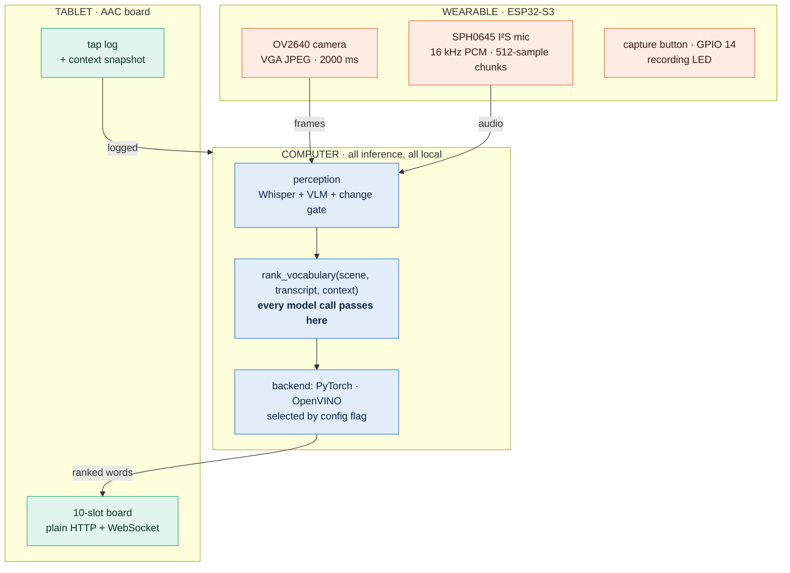
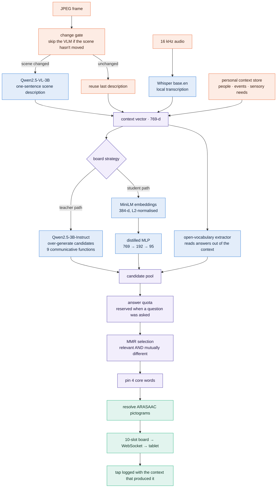
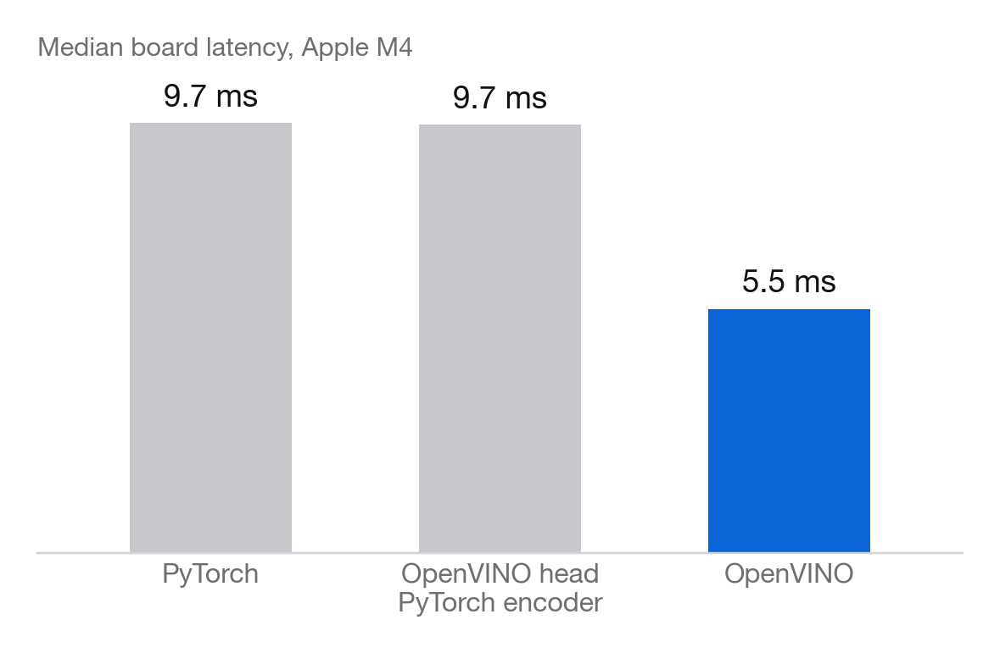
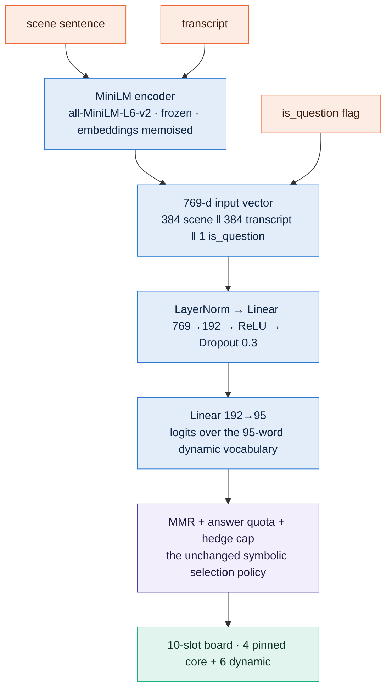
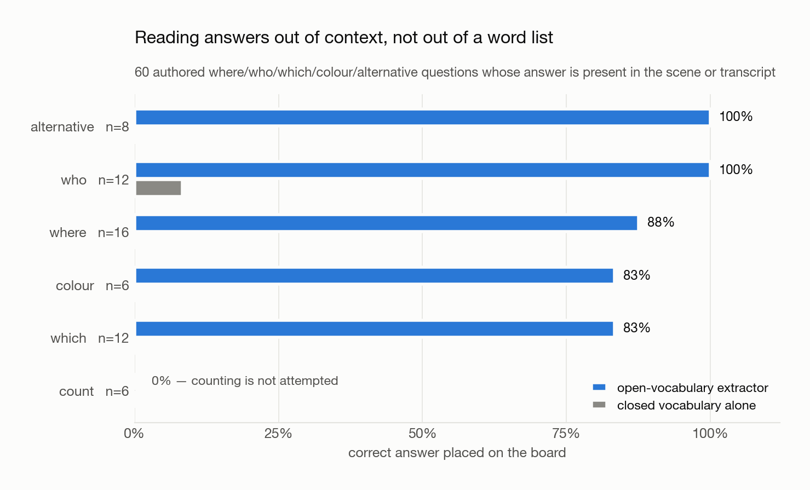

<div align="center">


# Revoce

Revoce is a wearable that listens to the conversation and looks at the room, so a
nonverbal person's AAC board has the words they need by the time they need them.
No one has to program it in advance.

**[revoce.ai](https://revoce.ai/)**

**Intel Global AI Impact Festival 2026 Global Award Winner** · **AI for Education Global Award Finalist** · **NeurIPS 2026 Workshops: SLM, ODI and GenAI4Health** · **International Society for Augmentative and Alternative Communication (ISAAC)**

[](https://www.python.org/)
[](https://pytorch.org/)
[](https://docs.openvino.ai/)
[](https://onnx.ai/)
[](https://www.espressif.com/)

<br />

<a href="https://www.youtube.com/watch?v=2Iy_1oze-cM">
  
</a>

<sub>▶ Our Intel Global AI Impact Festival 2026 video. Click to watch on YouTube.</sub>

</div>

---

## Why we built it

An AAC board is a grid of words and phrases that someone taps to communicate.
Somebody has to program that grid ahead of time, and nobody can predict every
situation a person will be in during the day. If the word you need isn't on the
board, you can't say it.

Around 4–5 million people in the U.S. can't reliably meet their daily
communication needs through speech. Speech-generating devices
cost $4,000 to $12,000 and can take 3 to 18 months to get reimbursed, and 30–35%
of them are abandoned within the first year, often because the vocabulary doesn't
match what the person needs to say. AAC users also communicate at about
a tenth of normal conversational speed.

## What it does

The board has ten slots. Four of them never change: *yes*, *no*, *I need help*
and *wait*. We picked those because each one does a different job, and we didn't
want a bad prediction to take them away. The other six update based on
what's going on around the user.

Say a student is in class and the teacher asks *"What do plants take in from the
air?"* The board might show:

> **carbon dioxide** · oxygen and water · sun · I am not sure · can you repeat that? · I know this one

Not everything on the board is an answer. The student can also say they're not
sure, ask to hear the question again, or show they want to join in.

Revoce can also suggest words that aren't in its built-in vocabulary. At a family
dinner, *"Who do you want to sit next to?"* can bring up **aunt**, even though that
word was never on the list. [The vocabulary problem](#the-vocabulary-problem)
explains how.

## How it works

There are three devices. The wearable captures audio and images, a computer runs
all the models, and a tablet shows the board. Neither the wearable nor the
tablet runs a model.



Every model call in the project goes through one function:

```python
rank_vocabulary(scene, transcript, context) -> ranked_words
```

Because of this, we could try different models and hardware without touching
anything else. Moving from PyTorch on a Mac to OpenVINO on Intel was a config
flag, with no changes to the firmware, the server or the UI.

### Picking the six words

We started by showing the six highest-scoring words, but that often gave six
versions of the same answer. Revoce now generates candidates across nine
communicative functions and picks six that are relevant and different from each
other.

The full path from the camera and mic to the board:




## How well it works

### Choosing the words

We compared our selection method with plain top-k ranking on 120 scenarios. Both
used the same candidates, so the only difference is how the six words are picked.

<p align="center">
  
</p>

Choosing for variety covered more of what the user might want to say and nearly
removed repeated suggestions.

### Speed

Our first version used a 3-billion-parameter model. The boards were good, but each
one took about seven seconds, which is too slow for a conversation.

We trained a much smaller model on the big one's boards. We generated 600
examples, kept 559 after removing duplicates, and set aside 84 that it never
trained on.

| | Small model | Original model |
|---|---:|---:|
| Time to build a board | **10.135 ms** | 7.05 s |
| Variety kept | 95.3% | — |
| Speedup | **695×** | — |

The 695× figure is based on eight timing runs of the original model. Its speed
depends on how busy the machine is (we've also measured 10.6 s and 11.7 s), so we
report the speedup as **over 400×**.

The small model has three parts: MiniLM encodes the input, a small neural network
scores the words, and the same selection step as before builds the board. The
scoring network is about 190 KB and runs in roughly 0.1 ms. Most of the remaining
time is spent in MiniLM, so moving MiniLM to OpenVINO cut the latency the most.

<p align="center">
  
</p>

The small model's architecture:




### Evaluation

These checks test whether the small model responds to the situation instead of
showing the same general-purpose board every time. A model that did that would
fail them.

| Check | Small model | Original model | Result |
|---|---:|---:|---|
| Distinct functions @7 | 4.095 | 4.298 | ✅ Pass |
| Near-duplicate rate | 0.000 | 0.0006 | ✅ Pass |
| Board variety | 0.952 | — | ✅ Pass (80 of 84 boards different) |
| Coverage of intent | 0.789 | 0.873 | ⚠️ Inconclusive |
| Same-function-pair rate | 0.1893 | 0.1735 | ❌ Fail |
| Word agreement with original | 0.067 | — | Tracked only |

Two of these still need work. The same-function-pair rate has failed three rounds
of testing, and every fix we've tried pushes coverage of intent below its
threshold. Coverage of intent clears its threshold by only 0.003 on 71 examples,
so we count it as inconclusive. We're working on improving both.

### The vocabulary problem

As we added training data, the small model agreed *less* often with the big
model's exact words: 23%, then 16%, then 6.7%. It kept passing every speed and
variety check.

The cause is the vocabulary. The big model can use any word, but the small one
picks from a fixed list of 95. That list can only cover
about a third of what the big model says, and making it 8.5× longer only gets you
to 57%.

<p align="center">
  
</p>

Word-for-word agreement wasn't a fair test, so we switched our main metric to
whether the board covers what the user might mean. We still report word
agreement separately.

We also added a step that takes answers directly from what the device sees and
hears. That's how *aunt* appears at dinner. We tested it on 60 questions where the answer is somewhere in the
scene or conversation. It got every *who* and *this-or-that* question right.
The fixed list alone got at most 8%.

<p align="center">
  
</p>

### Running on Intel

We exported the small model to ONNX and converted it to OpenVINO, with outputs
matching PyTorch to within `1.43e-6`. We also quantized it to INT8 with NNCF,
calibrated on 360 real inputs instead of random data. Every exported model includes
a hash of its word list, so loading it with the wrong list raises an error instead
of showing the wrong words.

We ran the same model file on an Apple M4 and an Intel Core Ultra 9 185H.

<p align="center">
  
</p>

Each number compares OpenVINO with PyTorch on the same machine, not the two
machines with each other. Moving MiniLM to OpenVINO as well made the whole board
2.02× faster on the Intel CPU, 1.85× on the Arc iGPU and 1.76× on the Mac.

INT8 made the model smaller (236 KB instead of 662 KB) but not faster. The model
doesn't run on the Intel NPU yet, because the NPU needs a fixed batch size and
our export uses a dynamic one. A fixed-size export is the next step.

## Getting started

You'll need Python 3.9 or newer. The big language and vision models run on Apple
silicon. On Intel, you can run the small model through OpenVINO instead (see
[`mac/intel/`](mac/intel/)).

```bash
git clone https://github.com/tanayvin1216/VoiceLink && cd VoiceLink
python3 -m venv .venv && source .venv/bin/activate
pip install -r mac/requirements-dev.txt
```

Run the tests (213 should pass):

```bash
cd mac
VOICELINK_PERCEPTION=0 pytest tests/ -q
```

Start the system:

```bash
bash mac/demo.sh              # real wearable, real models
bash mac/demo.sh --fake       # no ESP32 needed
bash mac/demo.sh --student    # the small model instead of the big one
bash mac/demo.sh --intel      # small model, MiniLM and Whisper on OpenVINO
bash mac/demo.sh --mock       # no models at all
```

The flags can be combined. Open the board at `http://<your-mac>:8080/` on a
tablet on the same Wi-Fi. We use plain HTTP so the tablet can connect without
HTTPS mixed-content errors.

## What's in the repo

| Path | What's there |
|---|---|
| [`mac/rank_vocabulary.py`](mac/rank_vocabulary.py) | Picks the words; every model call goes through here |
| [`mac/server.py`](mac/server.py) | Web server, live updates and tap logging |
| [`mac/evaluation/phase4/`](mac/evaluation/phase4/) | The small model, training and test results |
| [`mac/intel/`](mac/intel/) | OpenVINO conversion, quantization and benchmarks |
| [`firmware/voicelink_capture/`](firmware/voicelink_capture/) | Code for the ESP32-S3 wearable |
| [`docs/figures/make_figures.py`](docs/figures/make_figures.py) | Rebuilds every chart here from the saved results |
| [`paper/`](paper/) | Our NeurIPS 2026 workshop papers |

The charts are generated from results saved in the repo. If a chart and its JSON
disagree, the JSON is correct. To rebuild them, run
`python3 docs/figures/make_figures.py`.

## Privacy

Revoce has a camera and a microphone and is worn around other people, so privacy
for the user and the people near them is built into the hardware and software.

- **Local processing.** All models run on the computer. Audio, video and
  transcripts are never sent to a server.
- **No recordings.** Audio and images are held briefly in memory and never
  written to disk.
- **Off button.** A physical button on the wearable pauses capture. While it's
  paused, no audio is processed or sent and no pictures are taken.
- **Recording light.** An LED stays on whenever the device is capturing.
- **Consent.** The repo includes tools to pseudonymize the tap logs and a consent
  form for guardians of people who can't consent for themselves.

Until written consent is in place, we only test on members of our team.

## Credits

The pictograms come from [ARASAAC](https://arasaac.org/) under the CC BY-NC-SA
license, which doesn't allow commercial use. A commercial version would need a
different symbol set.
