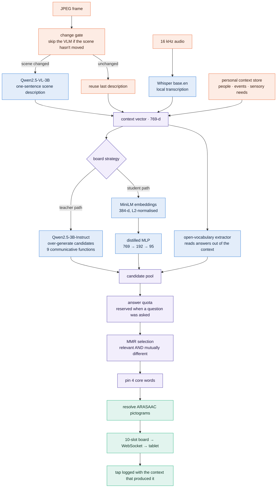
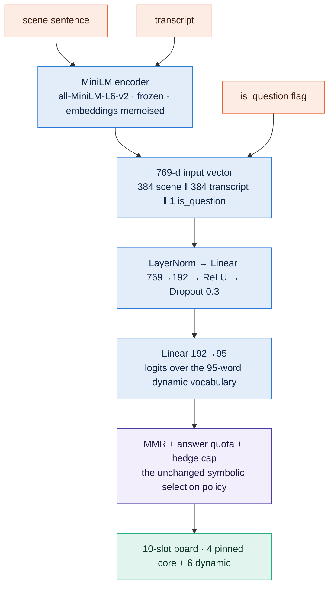
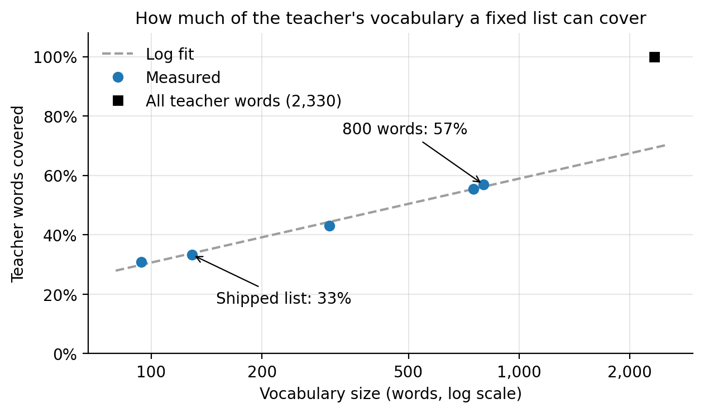
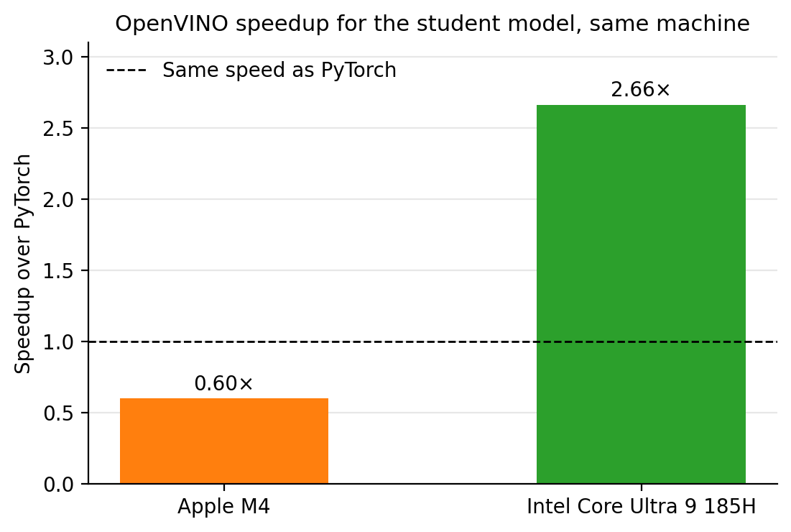

<div align="center">


# Revoce

Revoce is a wearable that listens to the conversation and looks at the room, so a
nonverbal person's AAC board has the words they need by the time they need them.
No one has to program it in advance.

**[revoce.ai](https://revoce.ai/)**

**Intel Global AI Impact Festival 2026 Global Award Winner** · **AI for Education Global Award Finalist** · **NeurIPS 2026 Workshops: SLM, ODI and GenAI4Health** · **International Society for Augmentative and Alternative Communication (ISAAC)**

[](https://www.python.org/)
[](https://pytorch.org/)
[](https://docs.openvino.ai/)
[](https://onnx.ai/)
[](https://www.espressif.com/)

</div>

---

## Why we built it

An AAC board is a grid of words and phrases that someone taps to communicate. The
catch is that somebody has to program that grid ahead of time, and nobody can
predict every situation a person will walk into during the day. If the word you
need isn't on the board, you can't say it.

This affects a lot of people. Around 4–5 million people in the U.S. can't reliably
meet their daily communication needs through speech. Speech-generating devices
cost $4,000 to $12,000 and can take 3 to 18 months to get reimbursed, and 30–35%
of them are abandoned within the first year, often because the vocabulary doesn't
match what the person actually needs to say. AAC users also communicate at about
a tenth of normal conversational speed. Sources are in
[`docs/COMPETITION_EVIDENCE.md`](docs/COMPETITION_EVIDENCE.md).

## What it does

The board has ten slots. Four of them never change: *yes*, *no*, *I need help*
and *wait*. We picked those because each one does a different job, and we didn't
want a bad prediction to ever take them away. The other six update based on
what's going on around the user.

Say a student is in class and the teacher asks *"What do plants take in from the
air?"* The board might show:

> **carbon dioxide** · oxygen and water · sun · I am not sure · can you repeat that? · I know this one

We wanted the board to do more than offer answers. The student can also say
they're not sure, ask to hear the question again, or just show they want to join in.

Revoce can also suggest words that aren't in its built-in vocabulary. At a family
dinner, *"Who do you want to sit next to?"* can bring up **aunt**, even though that
word was never on the list. More on how that works [below](#the-vocabulary-problem).

## How it works

There are three devices. The wearable captures audio and images, a computer runs
all the models, and a tablet shows the board. The wearable and the tablet never
run a model themselves.


Every model call in the project goes through one function:

```python
rank_vocabulary(scene, transcript, context) -> ranked_words
```

Keeping all the model code behind that one function made it easy to try
different models and hardware. When we moved from PyTorch on a Mac to OpenVINO on
Intel, it was a config flag. We didn't have to touch the firmware, the server or
the UI.

### Picking the six words

This is the part we spent the most time on. The obvious approach is to show the
six highest-scoring words, but that tends to give you six slightly different
versions of the same answer. So instead, Revoce generates candidates across nine
communicative functions and then picks six that are relevant *and* different from
each other.

Here's the full path from the camera and mic to the board:




## How well it works

### A better board, not just a likelier one

We tested the diverse selection against plain top-k ranking on 120 scenarios.
Both drew from the exact same candidates, so the only difference is how the six
words get picked.

<p align="center">
  
</p>

Picking for variety covered more of what the user might want to say and almost
got rid of repeated suggestions entirely.

### Making it fast enough to talk with

Our first version used a 3-billion-parameter model. The boards were good, but each
one took about seven seconds, and by then the conversation has moved on.

So we trained a much smaller model on the big one's boards. We generated 600
examples, kept 559 after removing duplicates, and set aside 84 that it never
trained on.

| | Small model | Original model |
|---|---:|---:|
| Time to build a board | **10.135 ms** | 7.05 s |
| Variety kept | 95.3% | — |
| Speedup | **695×** | — |

The 695× number comes from eight timing runs of the original model, and its speed
moves around depending on how busy the machine is (we've also seen 10.6 s and
11.7 s). So when we talk about the speedup, we say **over 400×** to be safe.

The small model is made of three pieces: MiniLM reads the input, a small neural
network scores the words, and the same selection step from before builds the
board. The scoring network is only about 190 KB and runs in roughly 0.1 ms. Almost
all the remaining time is MiniLM, which is why moving it to OpenVINO made such a
difference.

<p align="center">
  
</p>

And here's what the small model looks like inside:




### Checking it actually listens

We wanted to make sure the small model was really reacting to what's happening,
and not just showing the same generally useful board every time. A model that
did that should do badly on these checks.

| Check | Small model | Original model | Result |
|---|---:|---:|---|
| Distinct functions @7 | 4.095 | 4.298 | ✅ Pass |
| Near-duplicate rate | 0.000 | 0.0006 | ✅ Pass |
| Board variety | 0.952 | — | ✅ Pass (80 of 84 boards different) |
| Coverage of intent | 0.789 | 0.873 | ⚠️ Inconclusive |
| Same-function-pair rate | 0.1893 | 0.1735 | ❌ Fail |
| Word agreement with original | 0.067 | — | Tracked only |

Two of these still need work. The same-function-pair rate has failed three rounds
in a row, and every fix we've tried for it drags coverage of intent below its own
bar. Coverage of intent only clears its bar by 0.003 on 71 examples, which isn't
enough for us to call it a pass. We're still working on getting both right
without trading one for the other.

### The vocabulary problem

One result really surprised us. The more data we trained on, the *less* often the
small model picked the same words as the big one. It went from 23% to 16% to
6.7%, even though it kept passing every speed and variety check.

When we looked into it, the reason was simple. The big model can say any word it
wants, but the small one picks from a fixed list of 95. That list can only cover
about a third of what the big model says, and making it 8.5× longer only gets you
to 57%.

<p align="center">
  
</p>

So matching the big model word for word wasn't a fair test. We switched to
measuring whether the board covers what the user might mean, and kept word
agreement around as a side number.

A longer list wasn't going to fix it either. Instead, we added a step that pulls
answers straight out of what the device sees and hears. That's how *aunt* shows
up at dinner. We tested it on 60 questions where the answer is somewhere in the
scene or conversation. It got every *who* and *this-or-that* question right,
where the fixed list alone got at most 8%.

<p align="center">
  
</p>

The full write-up is in [`docs/overview/`](docs/overview/).

### Running on Intel

We exported the small model to ONNX and converted it to OpenVINO, with outputs
matching PyTorch to within `1.43e-6`. We also quantized it to INT8 with NNCF,
calibrated on 360 real inputs instead of random data. Every exported model comes
with a hash of its word list, so if it's ever loaded with the wrong list it fails
loudly instead of quietly showing the wrong words.

Then we ran the exact same file on an Apple M4 and an Intel Core Ultra 9 185H.

<p align="center">
  
</p>

Each number compares OpenVINO to PyTorch on the same machine, so differences
between the two computers don't skew it. Moving MiniLM to OpenVINO as well sped
up the whole board by 2.02× on the Intel CPU, 1.85× on the Arc iGPU and 1.76× on
the Mac.

A couple of things didn't go our way. INT8 made the model smaller (236 KB instead
of 662 KB) but not any faster. And we haven't gotten it running on the Intel NPU
yet, because the NPU needs a fixed batch size and our export uses a flexible one.
A fixed-size export is the next thing to try.

## Getting started

You'll need Python 3.9 or newer. The big language and vision models run on Apple
silicon. On Intel, you can run the small model through OpenVINO instead (see
[`mac/intel/`](mac/intel/)).

```bash
git clone https://github.com/tanayvin1216/VoiceLink && cd VoiceLink
python3 -m venv .venv && source .venv/bin/activate
pip install -r mac/requirements-dev.txt
```

Run the tests (213 should pass):

```bash
cd mac
VOICELINK_PERCEPTION=0 pytest tests/ -q
```

Then start everything up:

```bash
bash mac/demo.sh              # real wearable, real models
bash mac/demo.sh --fake       # no ESP32 needed
bash mac/demo.sh --student    # the small model instead of the big one
bash mac/demo.sh --intel      # small model, MiniLM and Whisper on OpenVINO
bash mac/demo.sh --mock       # no models at all
```

You can combine the flags. Open the board at `http://<your-mac>:8080/` on any
tablet on the same Wi-Fi. It's plain HTTP on purpose, so the tablet can connect
without running into HTTPS errors.

## What's in the repo

| Path | What's there |
|---|---|
| [`mac/rank_vocabulary.py`](mac/rank_vocabulary.py) | Picks the words; every model call goes through here |
| [`mac/server.py`](mac/server.py) | Web server, live updates and tap logging |
| [`mac/evaluation/phase4/`](mac/evaluation/phase4/) | The small model, training and test results |
| [`mac/intel/`](mac/intel/) | OpenVINO conversion, quantization and benchmarks |
| [`firmware/voicelink_capture/`](firmware/voicelink_capture/) | Code for the ESP32-S3 wearable |
| [`docs/VERIFIED_NUMBERS.md`](docs/VERIFIED_NUMBERS.md) | Every number in this README and where it comes from |
| [`docs/overview/`](docs/overview/) | The full technical write-up |
| [`docs/figures/make_figures.py`](docs/figures/make_figures.py) | Rebuilds every chart here from the saved results |
| [`paper/`](paper/) | Our NeurIPS 2026 workshop papers |

All the charts are generated from results saved in the repo. If a chart and its
JSON ever disagree, the JSON is right. Run
`python3 docs/figures/make_figures.py` to rebuild them.

## Privacy

Revoce has a camera and a microphone, and it's worn around other people, so we've
thought a lot about privacy for both the user and everyone near them. Most of it
is built into the hardware and software.

- **Everything stays local.** All the models run on the computer. Audio, video and
  transcripts are never sent anywhere.
- **Nothing gets saved.** Audio and images are held briefly in memory and never
  written to disk.
- **There's a real off button.** A physical button on the wearable pauses capture.
  While it's paused, no audio is processed or sent and no pictures are taken.
- **You can tell when it's on.** An LED stays lit whenever the device is capturing.
- **Consent comes first.** The repo includes tools to anonymize the tap logs and a
  consent form for guardians of people who can't consent for themselves.

Until written consent is in place, we're only testing it on our own team.

## Credits

The pictograms come from [ARASAAC](https://arasaac.org/) under the CC BY-NC-SA
license, which doesn't allow commercial use. A commercial version would need a
different symbol set.
