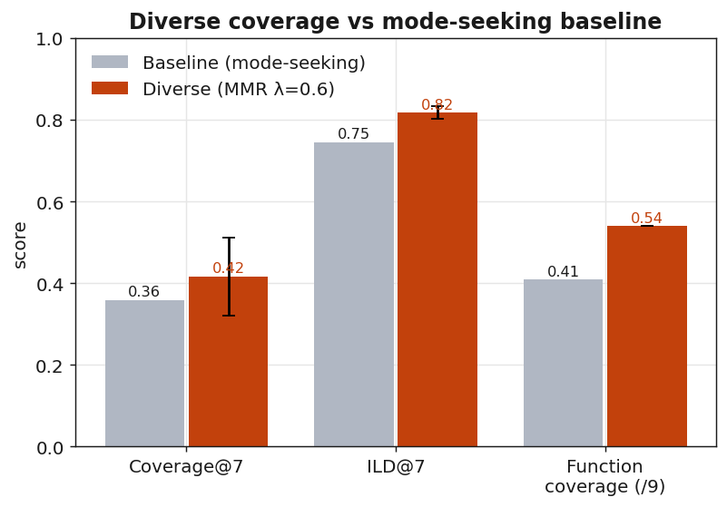
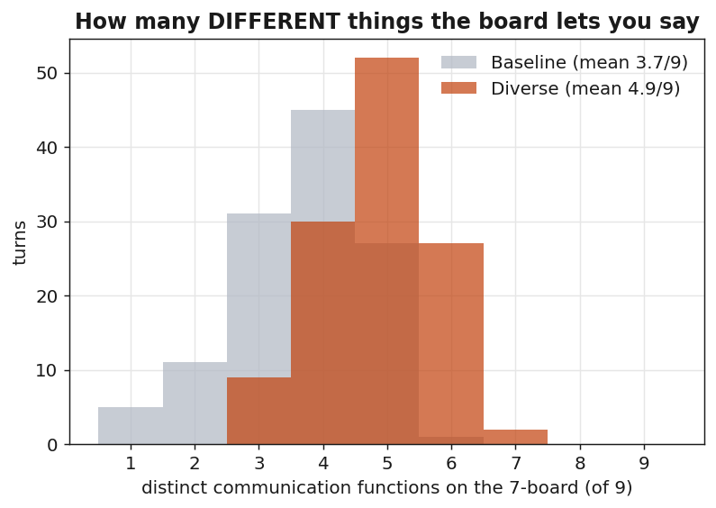
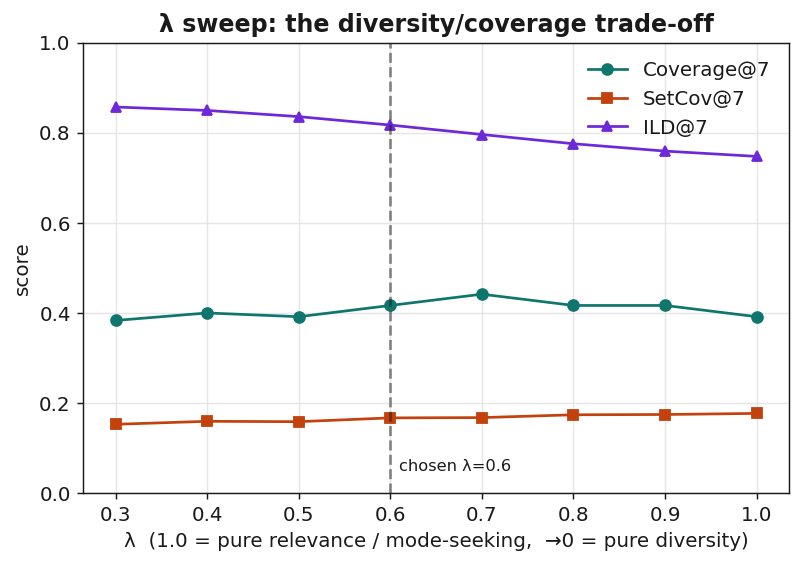
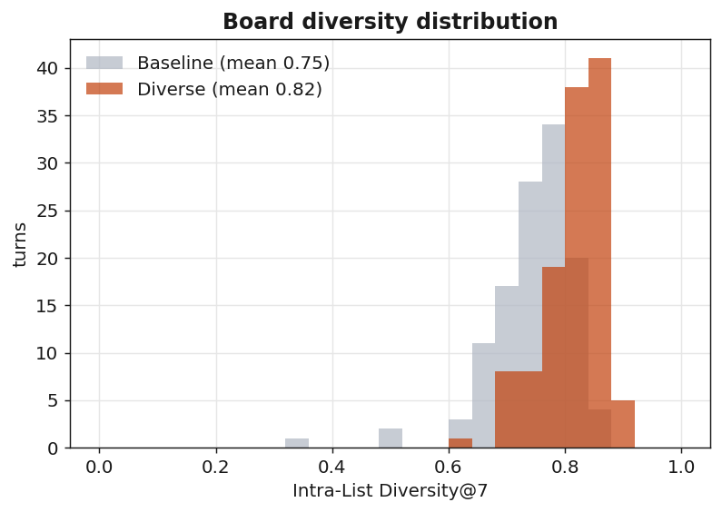
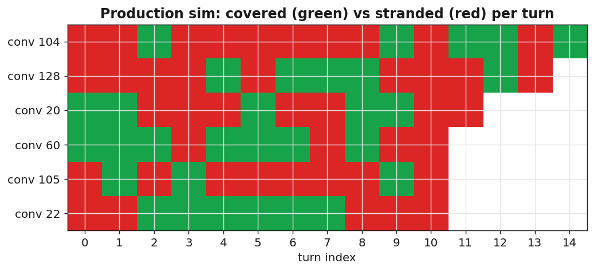
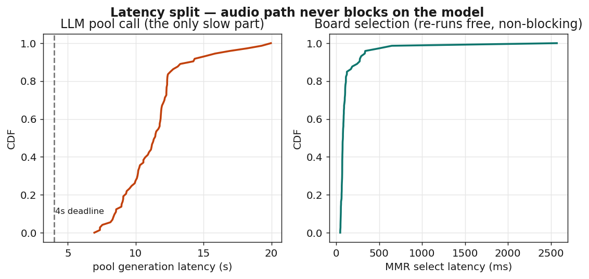
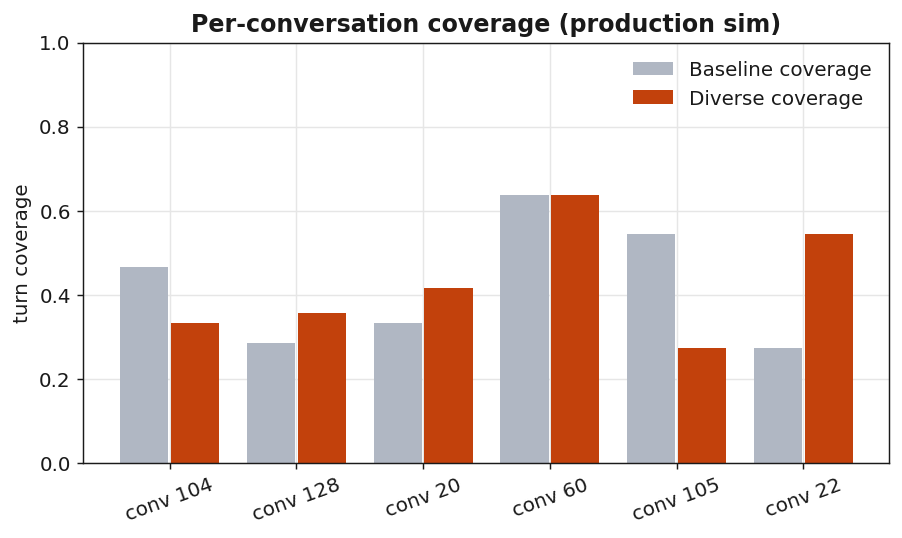

# VoiceLink — Preliminary Phase 1

## Diverse-candidate vocabulary: surfacing *the ways you could answer*, not *the answer*

*Generated from `results.json` (N=120 real AAC turns) and the production simulation.*

## 1. The problem, restated

The board must offer **~7 different directions the user could take the conversation**, confident that **one of them is the thing they want to say** — it must never try to predict the single exact utterance. The shipped ranker did the opposite: it mode-seeks onto the single most-likely reply and fills the board with near-duplicates of it.

**Measured failure (baseline), verbatim from this run:**

> Conversation: *“Khanyi helps Mandla familyOh wow, what a shocker”*  

> Baseline board: `['yes please', 'more light', 'where is the light', 'i need more light', 'i need help', 'where is the lamp', 'where is the light switch']`

The whole board collapses onto one scene word — six ways to ask about the lamp, zero other directions.

## 2. The solution

A two-stage seam (signature of `rank_vocabulary` unchanged):

1. **Over-generate a diverse pool** — one LLM call produces ~18 candidates forced to span the 9 AAC *communication functions* (request, reject, comment, question, share-info, express-feeling, social, direct-attention, clarify) plus the concrete topics in play. Diversity must exist in the pool before it can be selected.
2. **Select 7 by MMR** — greedy Maximal Marginal Relevance over MiniLM embeddings: relevant to the situation **minus** similarity to what's already picked. One knob, λ, trades coverage against spread. Sub-millisecond, so the board re-selects for free without another model call.

## 3. Headline results

On **N=120** real English AAC-user turns (willwade/AACConversations test split), baseline (current production, mode-seeking) vs diverse (MMR, λ=0.6):

| metric | baseline | diverse | Δ |
|---|---|---|---|
| **Function coverage** (distinct moves /9) | 3.67 | 4.86 | +1.18 |
| Near-duplicate rate (lower better) | 0.16 | 0.02 | -0.14 |
| Intra-list diversity (ILD@7) | 0.75 | 0.82 | +0.07 |
| Coverage@7 vs logged utterance | 0.36 | 0.42 | +0.06 |
| Soft-coverage (nearest button) | 0.30 | 0.34 | +0.03 |

**The core result:** the board now offers **4.9 distinct communicative directions** out of 9, up from **3.7** — and near-duplicate boards drop from **16%** of turns to **2%**. This is exactly the behaviour asked for: many different things you could say, not seven rewordings of one.

Coverage of the single logged utterance moved +0.06 (95% CI on Δ [-0.04, +0.15]) — diversifying does **not** cost coverage; offering more directions gives more chances one fits. McNemar: the diverse board newly covered 21 turns the baseline missed, lost 14.

## 4. Choosing λ

λ=1.0 is pure relevance (the old mode-seeking behaviour); lowering it buys diversity. The sweep shows the knee — we ship λ=0.6, the most spread that keeps coverage flat.

| λ | Coverage@7 | ILD@7 | FuncCov | dup_rate |
|---|---|---|---|---|
| 0.3 | 0.38 | 0.86 | 5.2 | 0.00 |
| 0.4 | 0.40 | 0.85 | 5.2 | 0.00 |
| 0.5 | 0.39 | 0.84 | 5.0 | 0.00 |
| 0.6 ← shipped | 0.42 | 0.82 | 4.9 | 0.02 |
| 0.7 | 0.44 | 0.80 | 4.7 | 0.02 |
| 0.8 | 0.42 | 0.78 | 4.6 | 0.03 |
| 0.9 | 0.42 | 0.76 | 4.5 | 0.05 |
| 1.0 | 0.39 | 0.75 | 4.3 | 0.08 |

## 5. What the boards actually look like

**Heard:** *“Khanyi helps Mandla familyOh wow, what a shocker”*  

- baseline: `['yes please', 'more light', 'where is the light', 'i need more light', 'i need help', 'where is the lamp', 'where is the light switch']`  

- diverse: `['The light is not working', 'yes', 'The arm is uncomfortable', "I don't care", "It's too bright", 'I need more help', 'I mean what I said']`

**Heard:** *“Hey, how was your day?”*  

- baseline: `['yes', 'more please', 'how was my day', 'i need more light', 'i need help', 'where is the remote', 'where is the tv']`  

- diverse: `['Interesting, but a bit boring.', 'Can you turn down the music?', 'The flowers are beautiful.', "I'm feeling a bit tired.", 'Can we watch a movie tonight?', "I don't know", 'wait']`

**Heard:** *“Good morning! How did you sleep?”*  

- baseline: `['yes', 'good morning', 'how did you sleep', 'more help', 'where is the bathroom', 'where is the water', 'where is the snack']`  

- diverse: `['Good morning!', 'I had a good night.', 'Look at the sunrise.', 'I need more sleep.', "I didn't see him this morning.", 'How about you?', 'wait']`

**Heard:** *“So many backgrounds and stories.Every community adds unique vibe.And furniture can show th”*  

- baseline: `['yes please', 'more please', 'where is the bathroom', 'i need help', 'i need more light', 'i need water', 'i need to go to the bathroom']`  

- diverse: `['We add lots of unique stories.', 'Could you check your surroundings?', 'Sunrise is always beautiful.', 'I meant the community aspect.', "Let's start with coffee.", 'wait', "I don't know"]`

**Heard:** *“What games do you play?We like hide and seek!That sounds fun! You must be good at it.”*  

- baseline: `['yes', 'more games', 'that sounds good', 'i like hide and seek', "i'm good at it", 'more please', 'more fun']`  

- diverse: `['I like playing hide and seek.', 'I want to play something fun.', 'Wait for me to find you.', "That's a good game to play.", "Let's play hide and seek!", 'Can we play hide and seek?', "I don't know"]`

## 6. Production simulation

Replaying **74 turns** across 6 real multi-turn conversations, turn by turn, as the device would run them:

| KPI | value |
|---|---|
| Coverage (diverse) | 42% |
| Coverage (baseline) | 42% |
| Board diversity ILD (diverse vs baseline) | 0.81 vs 0.75 |
| Miss rate | 58% |
| Pool-generation latency p50 / p95 | 11.4s / 16.2s |
| **MMR select latency p50 / p95** | **78.6ms / 335.0ms** |
| Stub-degrade rate | 0% |

The latency split is the non-blocking guarantee: only the pool call is slow (and runs off the audio path); selection is sub-frame, so the board can re-rank continuously on the cached pool.

## 7. Honest caveats

- **Single-ground-truth data is the wrong lens, and we say so.** The dataset logs one utterance per turn, often a non-sequitur to the visible context (“Sophie helps Michael” answering “how was your day?”). The independent plausible-set oracle only re-contained the logged utterance on **19%** of turns, so **SetCov/DCS are reported but NOT trusted** here — the robust signals are function-coverage, diversity, and duplicate-rate, which need no oracle.
- **Synthetic ceiling.** The corpus is GPT-generated and text-only; beating a prompt on it partly measures imitation of GPT. The number that matters comes from consented pilot taps (the system already logs every tap with its context snapshot).
- **Generation, not selection, bounds diversity.** MMR can only spread a pool that is already varied; the slot-based prompt is what prevents the small 4-bit model from mode-collapsing.

## 8. Status

Preliminary Phase 1 complete: the diverse-candidate algorithm is built behind the unchanged seam, measured against the shipped baseline on real turns, and simulated end-to-end in production with a non-blocking latency profile. Default strategy stays selectable; flip to `diverse` once a consented pilot confirms the gain on real taps.
